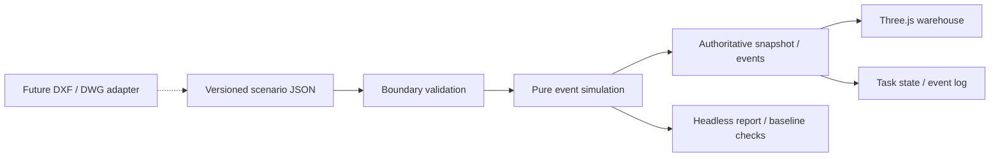

# Architecture

## Stack and boundaries

React + TypeScript orchestrates the application. Three.js renders a real local WebGL2 warehouse. A pure TypeScript discrete-event engine runs identically in the browser, unit tests, and the Node CLI. Vite builds the application. Vitest checks simulation contracts; Playwright exercises the actual viewport and workflows.

The renderer never computes transport progress independently. At simulation time `t`, the engine projects the current motion segment onto its floor edge and exposes an exact position. The render loop converts that snapshot into transforms. Advancing directly to `t` or advancing there with many small intervals must produce the same snapshot and event log.

## Scenario v1

- `schemaVersion: 1`, stable scenario ID/name, explicit `units: "m"`.
- `layout`: floor width/depth and axis-aligned rack footprints/heights.
- `nodes` and undirected `edges`: connected transport graph.
- `robot`: one AMR, start node, dimensions, constant travel speed, load/unload times.
- `tasks`: IDs, release times, pickup and drop-off nodes.

Input order breaks simultaneous-release ties. Routing is distance-based Dijkstra with stable input-order ties. Tasks use FIFO. The initial state processes releases at `t=0`. Units are metres, seconds, radians; floor axes are `x,z`, vertical axis `y`. Heading zero points along positive `z`.

## Task and pallet state

`scheduled → queued → to_pickup → loading → to_dropoff → unloading → completed`

The pallet remains at pickup through loading, attaches to the robot when loading completes, and transfers to the destination when unloading completes. There is one pallet per task. A task is counted complete only after that transfer. The loading and unloading durations are fixed assumptions, not rigid-body physics.

## Extensions

- **Multiple robots:** introduce explicit resource reservations, admission policy, queues, deadlock handling, and footprint/headway validation before exposing fleet controls.
- **CAD:** an adapter converts units/layers/geometry into an intermediate model. Human-assigned semantics produce racks, obstacles and stations. Preserve original layer/entity IDs for traceability. DXF `(x,y)` maps to floor `(x,z)`; never assume drawing units.
- **Charging:** add battery/charger resources to the engine and report energy assumptions; do not implement batteries only in the UI.
- **Forklifts:** introduce a kinematics strategy with steering/reverse/turn envelope and fork-service actions.
- **Long shifts:** add bounded event storage or persisted replay chunks and a worker for headless batch runs. The initial fixture is intentionally small.

## Offline and data boundaries

All initial assets are procedural and checked-in JSON. No CDN, model service, telemetry, backend, auth, or API key is required. JSON imports are size-limited and schema-validated. CAD conversion software and redistribution terms require a later adapter decision; H0 installs none.

## Decisions

See [ADR 0001](adr/0001-bootstrap.md). Keep framework-specific objects out of domain data and avoid a service/monorepo split until a real boundary requires it.
